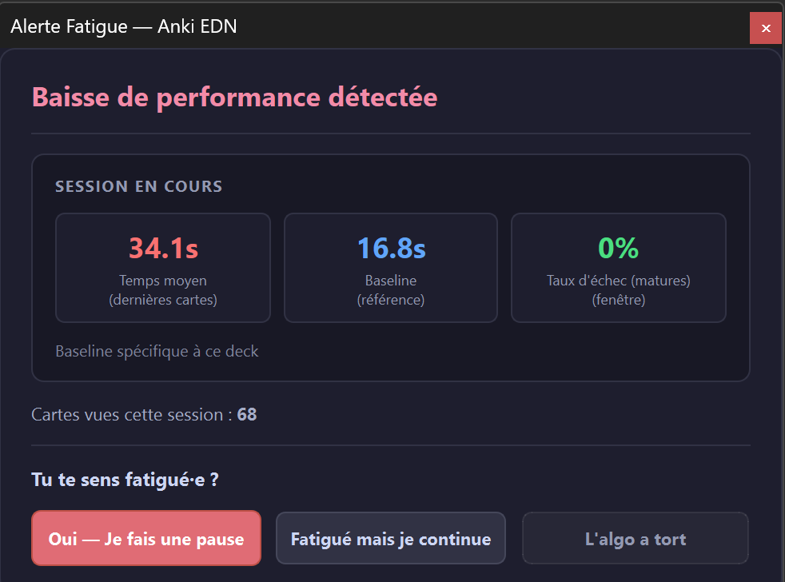

# 🧠 Fatigue Alert for Anki (Alerte Fatigue)

[](https://apps.ankiweb.net/)
[](https://opensource.org/licenses/MIT)
[](#-internationalization-i18n)

**Fatigue Alert** is an intelligent, non-intrusive Anki add-on designed to detect cognitive fatigue and declining review efficiency in real time. It monitors your response speed and error rates against your personal baseline, gently advising you when it is time to take a break.

---

## 📸 Overview & Screenshots

<div align="center">
  
</div>

---

## ✨ Features

- **⚡ Real-Time Fatigue Detection**:
  - Compares your current pace (sliding window) against your historical baseline (`revlog` or early-session reference).
  - Triggers an alert if you experience a sharp slowdown (e.g. 1.8× baseline) or a sudden spike in failed reviews (e.g. 60%+ errors).
- **🎯 Non-Intrusive & Floating Alert**:
  - Displays a clean floating alert in the top-right corner without blocking keyboard shortcuts or interrupting your study flow.
- **🧬 Self-Calibrating & Adaptive**:
  - **"Yes — Take a Break"**: Confirms fatigue and pauses the session.
  - **"Fatigued, but Continuing"**: Confirms fatigue while letting you keep reviewing.
  - **"Algorithm is Wrong"**: Dynamically lowers sensitivity to prevent false positives.
  - **"Report: Stopped Due to Fatigue"**: Explicitly log a fatigue stop from the *Tools* menu to adapt thresholds per deck.
- **🛡️ Anti-Spam & Cooldown**:
  - Minimum delays (e.g. 15 minutes / 20 cards) between alerts.
  - Pause tolerance (e.g. 2 min) keeps your session alive if you briefly step away.
- **🎨 Native Light & Dark Themes**:
  - Automatically matches Anki's Night Mode and UI styling.
- **🌍 Full Multilingual Support (i18n)**:
  - 17+ languages fully translated and automatically detected from Anki preferences.

---

## 🚀 Installation

### Via AnkiWeb (Recommended)
1. In Anki, go to **Tools** > **Add-ons** > **Get Add-ons...**
2. Enter the Add-on Code: `1071808091`
3. Restart Anki.

### Manual Installation (.ankiaddon / Source)
1. Download the `.ankiaddon` file from the [Releases](https://github.com/Ficello/Anki-Fatigue-Alert/releases) tab or clone this repository.
2. In Anki, open **Tools** > **Add-ons** > **Install from file...** and select `Anki_EDN_Fatigue_Alert.ankiaddon`.
3. Alternatively, copy the `Anki_EDN_Fatigue_Alert` folder directly into your Anki `addons21/` directory.

---

## ⚙️ Configuration & Usage

Access options directly through:
- **Tools** > **Fatigue Alert** > **Settings...**
- **Tools** > **Fatigue Alert** > **Enable Fatigue Detection** (quick toggle checkable directly in menu)
- **Tools** > **Fatigue Alert** > **Report: Stopped Due to Fatigue**

### Config Parameters (`config.json`)

| Parameter | Default | Description |
|---|---|---|
| `enabled` | `true` | Enable or disable fatigue detection. |
| `window_size` | `5` | Number of recent cards analyzed in the sliding window. |
| `baseline_cards` | `10` | Initial session cards used as baseline if no history is present. |
| `min_cards_before_alert` | `19` | Minimum number of cards before allowing the first alert. |
| `time_ratio_threshold` | `1.8` | Slowdown ratio triggering an alert (1.8× = 80% slower than baseline). |
| `error_rate_threshold` | `0.6` | Error rate ratio triggering an alert (0.6 = 60% failures in window). |
| `cooldown_minutes` | `15` | Minimum cooldown in minutes between two consecutive alerts. |
| `cooldown_cards` | `20` | Minimum cards reviewed between two consecutive alerts. |
| `pause_tolerance_minutes` | `2` | Time window within which resuming reviews continues the same session. |
| `use_revlog_baseline` | `true` | Analyze Anki's past `revlog` review history for baseline pace. |
| `revlog_baseline_days` | `30` | Number of past days analyzed for the revlog baseline. |

---

## 🌍 Internationalization (i18n)

## 🛠️ Project Structure

```text
Anki-Fatigue-Alert/
├── __init__.py           # Hook registrations & menu setup
├── alert_dialog.py       # Custom floating fatigue alert UI
├── analyzer.py           # Real-time pacing & error rate analysis engine
├── config.py             # Configuration getter, setter and defaults
├── config.json           # Default user configurations
├── deck_utils.py         # Deck resolution utilities
├── feedback_store.py     # SQLite persistence for feedback & adaptive thresholds
├── i18n.py               # Internationalization dictionary & locale detection
├── logger.py             # Add-on logging utility
├── manifest.json         # Anki add-on manifest metadata
├── settings_dialog.py    # Clean Qt settings dialog
├── docs/                 # Documentation assets & screenshots
├── LICENSE               # MIT License
└── README.md             # Repository documentation
```

---

## 📄 License

This project is licensed under the [MIT License](LICENSE).
